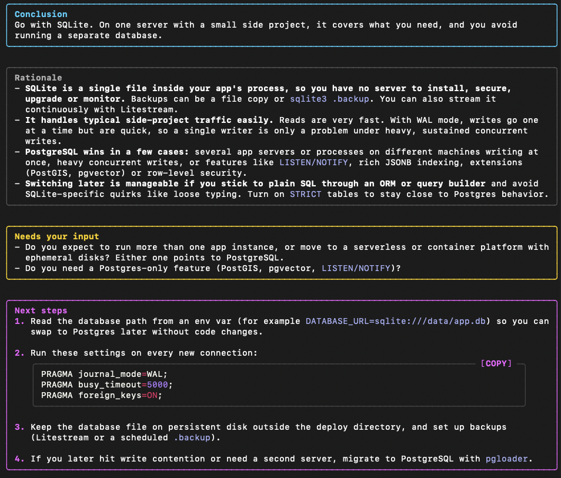
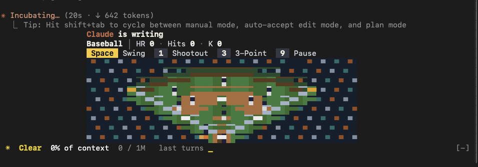
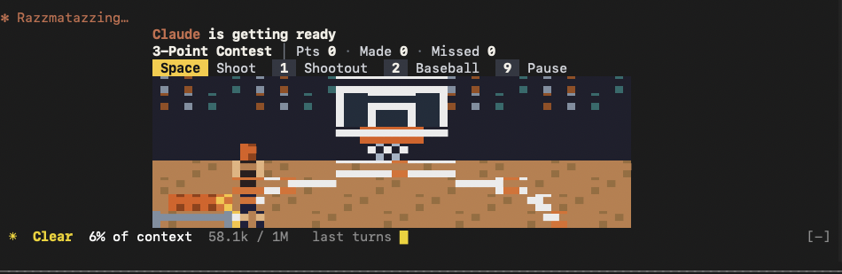

# flowvia-mods

Two mods for [Claude Code](https://code.claude.com) by FLOWVIA Labs.

| Mod | What it does |
|---|---|
| **neon-sections** | Splits Claude's answers into Conclusion / Rationale / Needs your input / Next steps and draws each section in its own neon box. Tool calls from a finished turn fold into one work-log line. |
| **clutch** | A sports minigame under the spinner while Claude works: penalty shootout, batting, and a 3-point contest, all played with the Space key. |







## Requirements

- Claude Code **v2.1.287 or later** in the terminal (mods are on by default from this version), or the desktop app v2.1.286 or later.
- Tested with Claude Code 2.1.304.
- **clutch runs in the terminal only** and needs a window at least 66 columns wide.

Mods use Claude Code's mod API, which is in early access. A Claude Code update can change that API, so a mod may stop working until it is updated here.

## Install

In a Claude Code session:

```
/plugin marketplace add FLOWVIA-Labs/flowvia-mods
/plugin install neon-sections@flowvia-mods
/plugin install clutch@flowvia-mods
```

Or from your shell:

```bash
claude plugin marketplace add FLOWVIA-Labs/flowvia-mods
claude plugin install neon-sections@flowvia-mods
claude plugin install clutch@flowvia-mods
```

Install one or both.

## Language

Both mods speak English and Korean. Each has a `language` option:

| Value | Behavior |
|---|---|
| `auto` (default) | Korean when your Claude Code `language` setting is Korean (`korean`, `ko`, `ko-KR`, `한국어`), English otherwise |
| `ko` | Always Korean |
| `en` | Always English |

Change it in `/plugin` → **Installed** → the mod → **Configure options**, or in `/config`.

## neon-sections

neon-sections asks Claude to structure answers with these headings and then draws them as boxes:

```
### Conclusion
### Rationale
### Needs your input
### Next steps
```

- A report on finished work can carry a status: `### Conclusion · Done`, `· Waiting`, or `· Blocked`. It shows as a badge on the Conclusion box.
- Korean headings (`### 결론` and so on) are recognized too, whatever the language setting.
- Short answers and progress notes between tool calls stay plain text.
- When a turn ends, its tool calls fold into one **Work log** line. In the desktop app and the fullscreen terminal you can expand it.
- Code blocks get a **COPY** button in the desktop app and the fullscreen terminal.

### Settings

Run `/ns-setting` to open the settings panel. You can set:

- each section's color for dark and light themes
- effects: double-border glow, neon on the latest answer only, highlight on hover, blink, and breathe. Effects other than glow work in the desktop app and the fullscreen terminal only.

The same settings are available as commands:

| Command | Effect |
|---|---|
| `/ns-setting on` / `off` | Turn the boxes on or off |
| `/ns-setting status` | Show the current settings |
| `/ns-setting color <section> #RRGGBB [dark\|light]` | Set a section color |
| `/ns-setting effect <glow\|latest\|hover\|blink\|breathe> <section> <on\|off>` | Toggle an effect |
| `/ns-setting fold <on\|off>` | Fold tool calls into the work log |

`<section>` is `conclusion`, `attention`, or `next` (or the heading text). The Rationale box always uses a fixed gray.

## clutch

When Claude starts working, a small field appears under the spinner. Each new prompt picks a sport at random, and a long task switches sports every minute.

| Key | Action |
|---|---|
| Space | Shoot or swing |
| 1 / 2 / 3 | Switch to penalty shootout / baseball / 3-point contest |
| 9 | Pause the game for this turn |

- Game keys are read only while Claude is working and the prompt box is empty. Once you start typing, keys go to the prompt as usual. To start a message with Space, 1, 2, 3, or 9, press 9 first to pause the game.
- The scoreboard shows what Claude is doing right now (thinking, editing a file, running tests, and so on).
- `/clutch` turns the game on or off.

## Privacy

- Neither mod makes network requests.
- Both mods read your Claude Code settings only for the `language` value and the light/dark theme, and never send them anywhere.
- clutch stores two values locally: the last sport played and whether the game is on.

## Development

See [AGENTS.md](AGENTS.md) for the layout, setup, and test commands.

## License

[MIT](LICENSE) © FLOWVIA Labs

Not affiliated with, endorsed by, or sponsored by Anthropic. "Claude" and "Claude Code" are used only to describe what these mods work with.
